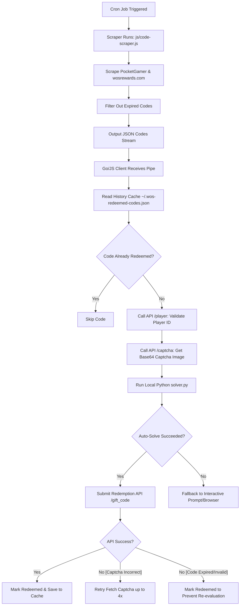

# ❄️ Whiteout Survival Auto-Redeemer (v3.0)

[](https://www.gnu.org/licenses/gpl-3.0)

> **Never miss a Whiteout Survival reward again.** Sit back, relax, and let your free in-game gifts flow directly to your account daily.

**Whiteout Survival Auto-Redeemer** is a high-performance, zero-dependency automation suite written in **Go** and **Node.js** that manages the entire gift-code lifecycle. By uniting multi-source web scraping, machine-learning CAPTCHA solving, smart player-ID resolution, state caching, and daily `cron` scheduling, it provides a flawless, set-and-forget experience for players.

---

## 🔥 Key Features

* **Dual-Source Code Scraper**: Aggregates, cleans, and merges active codes from both **PocketGamer** and **WOSRewards.com** dynamically.
* **Smart Expiry Filtering**: Uses real-time status tracking on `wosrewards.com` to weed out expired codes before they hit your API queue.
* **Offline ML CAPTCHA Solver**: Integrates an offline machine-learning OCR solver (`ddddocr` + OpenCV bilateral filtering) achieving **>93% success rates** in 2 attempts, completely avoiding commercial captcha API costs.
* **State Caching & Rate Limit Protection**: Prevents redundant network calls by caching successfully redeemed codes on a per-player basis, observing a safe 10-second backoff between calls to comply with API rate limits.
* **Flexible Player ID Precedence**: Resolves Player IDs (`fid`) elegantly: CLI flag `-u` > env variable `DEFAULT_FID` > local `.env` > global `~/.wos-cli-env` > default fallback.
* **Zero Dependencies**: Core clients are built strictly on standard libraries (no external runtimes needed for Node/Go, keeping them lightweight and ultra-secure).

---

## 📋 Requirements

* **Node.js >= 18** (for the Node client and JS scraper)
* **Go >= 1.21** (for compiling the Go binary client)
* **Python 3.8+** (for the offline CAPTCHA solver; optional, falls back to manual entry)
* An OS with a default browser or image viewer (macOS `open`, Windows `start`, Linux `xdg-open` for manual fallbacks)

---

## 🚀 Quick Start

### 1. Setup the CAPTCHA Solver (Optional)
Run the script to initialize a local Python virtual environment and download the solver model:
```bash
./setup_solver.sh
```

### 2. Node.js Client
Run the client with a specific Player ID and code:
```bash
node js/wos-client.js -u 123456789 HAPPY2026
```
Or process a JSON file containing multiple codes:
```bash
node js/wos-client.js -u 123456789 -f codes.json
```

### 3. Go Client
Run the Go client directly:
```bash
go run ./go -u 123456789 HAPPY2026
```
Build a precompiled binary for maximum performance:
```bash
# Build binary for current platform (outputs to dist/)
./go/build.sh
# Build binaries for macOS/Linux/Windows
./go/build.sh all
```

---

## 🛠️ Automated Cron Redemption Pipeline (Zero-Touch)

You can configure the client to run entirely in the background once a day using `cron`. The automated pipeline fetches the latest active codes, filters out expired ones, and submits them to the redemption engine.

### Pipeline Layout Directory Structure

```text
$HOME/                       # Your user home directory (/Users/username)
├── .wos-cli-env             # Global config file (defines your DEFAULT_FID)
├── .wos-redeemed-codes.json # History cache (tracks successfully redeemed codes)
└── work/                    # Parent workspace directory
    ├── cron-wos-codes.sh    # Executable runner script (Step 1 below)
    └── wos-giftcode-cli/    # Checked-out repository folder
        ├── dist/
        │   └── wos-client-darwin-arm64  # Precompiled Go client binary
        └── js/
            └── code-scraper.js          # The scraper script
```

### Setup Steps

1. **Copy the Runner Script**:
   Copy the script from the repository's `util/` directory up into your `$HOME/work/` parent directory:
   ```bash
   cp util/cron-wos-codes.sh $HOME/work/cron-wos-codes.sh
   chmod +x $HOME/work/cron-wos-codes.sh
   ```
2. **Configure your Player ID**:
   Create your global config containing your player ID (replace `YOUR_PLAYER_ID` with your actual in-game ID):
   ```bash
   echo "DEFAULT_FID=YOUR_PLAYER_ID" > ~/.wos-cli-env
   ```
3. **Schedule with Crontab**:
   Open your cron table:
   ```bash
   crontab -e
   ```
   Add the following line to run the automated redemption pipeline every day at midnight, logging output to `/tmp/wos-cron.log`:
   ```text
   0 0 * * * $HOME/work/cron-wos-codes.sh > /tmp/wos-cron.log 2>&1
   ```

---

## 🔍 Technical Flow

Here is the lifecycle of a fully automated run:



1. **Scraping**: `code-scraper.js` fetches working codes from PocketGamer and `wosrewards.com`. It reads the status badges on `wosrewards.com` and filters out any codes that are expired.
2. **Resolution & Load**: The client loads the configuration settings and checks the local history cache (`.wos-redeemed-codes.json`).
3. **Verification**: For each candidate code, the client calls `/player` to verify that the player ID exists and prints player profile data.
4. **CAPTCHA Auto-Solving**: The client requests a CAPTCHA via `/captcha`, cleans the image using an OpenCV bilateral filter (to smooth background grid lines and noise circles), and passes the bytes to `ddddocr` in Python. 
5. **Redemption**: If solved, the code is redeemed via `/gift_code`. On success (or if the code is invalid/expired), the code is marked as processed in the history cache to avoid hammering the API on subsequent daily runs.

---

## 🔒 Signature Security (`appendSign`)

All requests are signed using MD5 hashing to match the game's Web Application Firewall (WAF) requirements:
1. Sort query parameters alphabetically by key.
2. URL-encode parameter values (matching Javascript's `encodeURIComponent` byte-for-byte).
3. Append a fixed developer salt: `tB87#kPtkxqOS2`.
4. Generate the MD5 digest and include it in the headers alongside standard browser `Origin` and `Referer` settings.

---

## 📦 CI/CD (GitHub Actions)

* **Build Workflow (`build.yml`)**: Verifies code health with `go vet`, compiles targets for macOS, Linux, and Windows (AMD64 & ARM64) using `go/build.sh all`, and uploads them as build artifacts.
* **Release Workflow (`release.yml`)**: Triggers on signed tag pushes (`v*`). Verifies tag signature authenticity via SSH allowed signers, builds release targets, generates changelogs automatically from commit logs, and creates a formal GitHub release.

---

## 📄 License

This project is licensed under the **GNU General Public License v3.0**. See the [LICENSE](./LICENSE) file for the full text.
