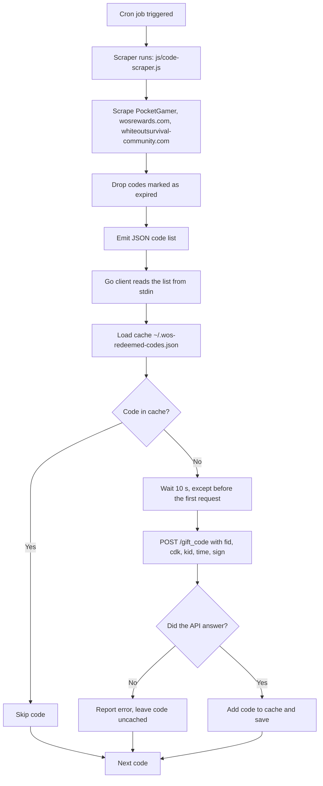

# ❄️ Whiteout Survival Auto-Redeemer (v4.0)

[](https://www.gnu.org/licenses/gpl-3.0)

> **Never miss a Whiteout Survival reward again.** Sit back, relax, and let your free in-game gifts flow directly to your account daily.

**Whiteout Survival Auto-Redeemer** collects active gift codes from several community sites and redeems them for your account. A **Node.js** scraper gathers the codes, a **Go** client redeems them, and a daily `cron` job ties the two together for a set-and-forget setup.

A redemption is a single signed request that carries your **player ID** and your **state number**. See [BACKEND_PROTOCOL.md](./BACKEND_PROTOCOL.md) for the protocol details.

---

## 🔥 Key Features

* **Multi-Source Code Scraper**: Merges active codes from **PocketGamer**, **wosrewards.com** and **whiteoutsurvival-community.com**.
* **Expiry Filtering**: A code that any source marks as expired is dropped, even if another source still lists it as active.
* **One Request per Code**: Each code is redeemed with one signed call to `/gift_code`.
* **State Caching & Rate Limit Protection**: Processed codes are cached per player so they are never sent twice, and the client waits 10 seconds between requests.
* **Flexible Configuration**: Player ID and state number are resolved from CLI flags, environment variables, a local `.env` or a global `~/.wos-cli-env`.
* **Zero Dependencies**: The Go client and the scraper use only their standard libraries.

---

## 📋 Requirements

* **Go >= 1.21** to build the client
* **Node.js >= 18** to run the code scraper

---

## 🚀 Quick Start

### 1. Find your player ID and state number

Both are shown in your in-game profile: the player ID below your name, and the state as `#1234` next to it. The API calls them `fid` and `kid`.

### 2. Build the client

```bash
# Build a binary for the current platform (outputs to dist/)
./go/build.sh
# Build binaries for macOS, Linux and Windows
./go/build.sh all
```

Binaries are named `dist/wos-client-<os>-<arch>`, for example `dist/wos-client-darwin-arm64`.

### 3. Redeem a code

```bash
dist/wos-client-darwin-arm64 -u 123456789 -k 1234 HAPPY2026
```

Or without building first:

```bash
cd go && go run . -u 123456789 -k 1234 HAPPY2026
```

### 4. Redeem all currently active codes

```bash
node js/code-scraper.js | dist/wos-client-darwin-arm64 -u 123456789 -k 1234
```

---

## ⚙️ Client Usage

```text
wos-client [-u playerid] [-k state] <code>
wos-client [-u playerid] [-k state] -f <codes.json>
```

| Flag | Meaning |
|------|---------|
| `-u` | Player ID (`fid`) |
| `-k` | State number (`kid`) |
| `-f` | JSON file with codes to redeem; `-` reads from stdin |

When no code and no `-f` is given, the client reads the code list from stdin if input is piped, and otherwise prompts for a single code.

### Code list format

`-f` and stdin accept any of these JSON shapes:

```json
[{ "code": "HAPPY2026" }, { "code": "WOS1234" }]
```
```json
["HAPPY2026", "WOS1234"]
```
```json
{ "code": "HAPPY2026" }
```

The scraper emits the first shape, so its output can be piped straight into the client.

### Player ID and state number

Each value is resolved separately, highest priority first:

1. CLI flag: `-u`, `-k`
2. Environment variable: `DEFAULT_FID`, `DEFAULT_KID`
3. `.env` in the current working directory (see [example.env](./example.env))
4. `~/.wos-cli-env`
5. Built-in placeholder (`123456789` / `1234`)

Config files use `KEY=value` lines; `export` prefixes and quotes are accepted:

```bash
DEFAULT_FID=123456789
DEFAULT_KID=1234
```

> **Set both keys in `~/.wos-cli-env`.** When that file exists, both values are taken from it, so a missing key leaves that value empty rather than falling back to the placeholder.

### Redeemed-code cache

The client records every processed code in `~/.wos-redeemed-codes.json`, grouped by player ID. Cached codes are skipped on later runs without contacting the API. Matching is case-insensitive.

A code is cached when the API answers, whether it was redeemed or rejected (already claimed, expired, invalid), because asking again would not change the answer. A request that fails before the API answers is not cached, so the code is retried on the next run.

To redeem a code again, remove it from the cache file.

---

## 🕸️ Code Scraper

```bash
node js/code-scraper.js              # print the JSON code list to stdout
node js/code-scraper.js -o codes.json # write it to a file
```

Sources:

* `https://www.pocketgamer.com/whiteout-survival/codes/`
* `https://wosrewards.com`
* `https://www.whiteoutsurvival-community.com/en/gift-codes.html`

A source that cannot be reached only produces a warning; the remaining sources are still used. The scraper exits with an error when no active code is found at all.

Run the scraper tests with:

```bash
cd js && npm test
```

---

## 🛠️ Automated Cron Redemption Pipeline (Zero-Touch)

The pipeline fetches the current codes once a day and redeems the ones your account has not processed yet. [util/INSTALL_CRON.md](./util/INSTALL_CRON.md) has the same steps in more detail.

### Directory layout

```text
$HOME/
├── .wos-cli-env             # Global config (DEFAULT_FID and DEFAULT_KID)
├── .wos-redeemed-codes.json # Cache of processed codes
└── work/
    ├── cron-wos-codes.sh    # Runner script (copied in step 1)
    └── wos-giftcode-cli/    # This repository
        ├── dist/
        │   └── wos-client-darwin-arm64  # Go client binary
        └── js/
            └── code-scraper.js          # The scraper
```

### Setup steps

1. **Copy the runner script** next to the repository:
   ```bash
   cp util/cron-wos-codes.sh $HOME/work/cron-wos-codes.sh
   chmod +x $HOME/work/cron-wos-codes.sh
   ```
   The script calls `dist/wos-client-darwin-arm64`. Change the binary name in it if you run on another platform.
2. **Configure your player ID and state number**:
   ```bash
   printf 'DEFAULT_FID=YOUR_PLAYER_ID\nDEFAULT_KID=YOUR_STATE\n' > ~/.wos-cli-env
   ```
3. **Schedule with crontab** (`crontab -e`). This runs the pipeline every day at midnight and logs to `/tmp/wos-cron.log`:
   ```text
   0 0 * * * $HOME/work/cron-wos-codes.sh > /tmp/wos-cron.log 2>&1
   ```

---

## 🔍 Technical Flow



1. **Scraping**: `code-scraper.js` collects codes from all sources and removes any code a source marks as expired.
2. **Configuration**: The client resolves player ID and state number and loads the cache.
3. **Redemption**: Each uncached code is sent to `/gift_code` in one signed request, with a 10-second pause between requests.
4. **Caching**: Every code the API answered for is cached; failed requests are retried on the next run.

---

## 🔒 Request Signature (`appendSign`)

Every request carries a `sign` form field so the API accepts it:

1. Sort the parameters alphabetically by key.
2. URL-encode each value exactly like JavaScript's `encodeURIComponent` and join the pairs as `key=value&key=value`.
3. Append the fixed salt `tB87#kPtkxqOS2`.
4. Take the MD5 digest as a hex string and send it as the `sign` field alongside the other parameters.

Requests also need browser-like `Origin`, `Referer` and `User-Agent` headers. [BACKEND_PROTOCOL.md](./BACKEND_PROTOCOL.md) has a worked example.

---

## 📦 CI/CD (GitHub Actions)

* **Build workflow (`build.yml`)**: Runs `go vet`, then builds the client for macOS, Linux (AMD64 and ARM64) and Windows (AMD64) with `go/build.sh` and uploads one artifact per platform.
* **Release workflow (`release.yml`)**: Runs on `v*` tag pushes. It verifies the tag's SSH signature against the allowed signers, builds the release binaries, generates a changelog from the commit log and creates a GitHub release.

---

## 📄 License

This project is licensed under the **GNU General Public License v3.0**. See the [LICENSE](./LICENSE) file for the full text.
